# Forensic License Plate Super-Resolution, Restoration & Autonomous OCR Pipeline

[](https://www.python.org/)
[](https://pytorch.org/)
[](https://streamlit.io/)
[](https://www.nvidia.com/)

A modular computer vision and deep learning system designed for vehicle license plate localization, scene deblurring, perspective homography rectification, image quality assessment (IQA), super-resolution, dual-path optical character recognition (OCR), and traffic video ANPR with deep visual re-identification deduplication.

---

## 📑 Table of Contents
1. [Key Architecture & Workflow](#-key-architecture--workflow)
2. [Project & Directory Structure](#-project--directory-structure)
3. [Setup & Installation](#-setup--installation)
4. [Streamlit Web Application](#-streamlit-web-application)
5. [Pipeline Execution Guide](#-pipeline-execution-guide)
6. [Interactive Jupyter Notebook (2xT4 Optimized)](#-interactive-jupyter-notebook)
7. [Benchmark Evaluation & Progressive Baselines](#-benchmark-evaluation--progressive-baselines)
8. [Offline Model Weights](#-offline-model-weights)

---

## 🧠 Key Architecture & Workflow

The forensic recognition engine processes real-world vehicles through a 9-stage modular pipeline:

```mermaid
flowchart LR
    A["Raw Scene Image / Video Frame"] --> B["Stage 1: GoPro NAFNet Deblurring"]
    B --> C["Stage 2: YOLOv8 Plate Localization"]
    C --> D["Stage 3: Quadrilateral Rectification & Deskewing"]
    D --> E["Stage 4: Objective Quality Assessment (IQA)"]
    E --> F["Stage 5: Adaptive Enhancement Ladder (CLAHE, NLM, Real-ESRGAN x4)"]
    F --> G["Stage 6: Dual-Path RapidOCR (Standard + Inverted)"]
    G --> H["Stage 7: Consensus Candidate Voting & Syntax Validation"]
    H --> I["Verified License Plate Output"]
```



1. **Scene Deblurring**: Restores camera jitter and motion blur on full-frame scenes using official GoPro NAFNet with adaptive downscaling memory protection.
2. **Autonomous Plate Localization**: Uses dedicated vehicle license plate detector (`joker5914/yolov8n-license-plate`) trained specifically on license plate boundaries.
3. **Geometric Rectification**: Employs contour analysis, robust quadrilateral corner sorting, and perspective homography transformation to correct skewed perspective angles.
4. **Image Quality Assessment (IQA)**: Computes objective metrics including patch noise variance, Laplacian sharpness, normalized contrast percentile formula `(p95-p5)/255`, and character height.
5. **Adaptive Multi-Candidate Routing**: Dynamically generates an enhancement ladder:
   - *Rectified Unprocessed*
   - *Adaptive Targeted (CLAHE + Non-Local Means + Unsharp Sharpening)*
   - *Deep Super-Resolution (Real-ESRGAN x4 native and 2x downsampled)*
   - *Adaptive Residual Morphological Re-inking*
6. **Dual-Path OCR Recognition**: Transcribes each candidate in both standard and inverted grayscale via RapidOCR / PaddleOCR ONNX Runtime.
7. **Consensus Candidate Voting**: Reconciles candidate predictions, resolves character ambiguities, applies Indian plate syntax validation, and outputs the consensus transcription.
8. **Video ANPR & Re-ID Deduplication**: Tracks vehicles via ByteTrack, extracts appearance embeddings via ResNet-18, rejects false-positive "no plate" crops, and eliminates duplicate vehicle tracklets.

---

## 📁 Project & Directory Structure

```
CerebralZip_Assignment2/
│
├── .gitignore                              # Git exclusion rules (ignores data/, cache, checkpoints)
├── app.py                                  # Streamlit interactive web application
├── forensic_license_plate_pipeline.ipynb   # Complete 2xT4-optimized all-in-one notebook
├── forensic_pipeline.py                 # Central import facade for forensic modules
├── requirements.txt                        # Python dependencies
├── run_pipeline.py                         # Master CLI pipeline runner
├── setup.py                                # Standard Python setup & installation script
├── README.md                               # Project documentation & run guide
│
├── models/                                 # Centralized offline model weights directory
│   ├── yolov8n.pt                          # Vehicle detector model (traffic tracking)
│   ├── plate_detector.pt                   # Dedicated license plate YOLOv8 detector
│   ├── NAFNet-GoPro-width32.pth            # Deep learned motion deblurring weights
│   └── RealESRGAN_x4.pth                   # Deep super-resolution weights
│
├── scripts/                                # Modular pipeline components
│   ├── setup_models.py                     # Offline weights downloader & validator
│   ├── data_prep.py                        # Dataset preparation & VOC parser
│   ├── detection.py                        # YOLOv8 license plate detection module
│   ├── deblurring.py                       # NAFNet motion deblurring module
│   ├── geometry.py                         # Homography & deskewing module
│   ├── quality_assessment.py               # Comprehensive forensic IQA module
│   ├── restoration.py                      # Classical restoration suite (CLAHE, NLM, sharpen)
│   ├── super_resolution.py                 # Real-ESRGAN x4 RRDBNet module (FP32)
│   ├── routing.py                          # Quality-adaptive ladder router
│   ├── ocr_recognition.py                  # Dual-path RapidOCR transcription module
│   ├── ocr_candidate_selection.py          # Candidate selection & voting module
│   ├── pipeline.py                         # Main forensic image pipeline coordinator
│   ├── video_pipeline.py                   # Video ANPR & deep Re-ID deduplication
│   ├── evaluation_metrics.py               # True IoU, AP, CER, Levenshtein distance
│   ├── evaluation.py                       # 3-way baseline benchmark engine
│   ├── visualization.py                    # 4-panel diagnostic card generator
│   └── __init__.py                         # Package exports
│
├── data/                                   # Real-world Indian license plate dataset (gitignored)
│   ├── dataset_prepared/                   # Collision-free unified dataset
│   │   ├── images/                         # Real-world vehicle images
│   │   ├── annotations/                    # Synchronized Pascal VOC XML annotations
│   │   ├── labels/                         # Normalized YOLO multi-plate bounding boxes
│   │   ├── manifest.json                   # Verified manifest metadata
│   │   └── ground_truth.csv                # Tabular metadata
│   └── videos/                             # Sample traffic footage (.mp4)
│
└── results/                                # Output artifacts directory
    ├── comparative_cards/                  # 15-sample comparative before/after cards
    │   ├── comparative_card_01_AR13.png    # Composite: Before | Extracted | After | OCR+PSNR+SSIM
    │   ├── ...                             # (15 composite PNG images in total)
    │   ├── COMPARATIVE_REPORT.md           # Markdown report with PSNR & SSIM table
    │   └── comparative_summary.json        # Quantitative summary metrics JSON
    ├── step_by_step_visualizations/        # 15-sample granular 8-stage pipeline progression cards
    │   ├── step_progression_01_AR13.png    # 8-panel progression: Original -> NAFNet -> Crop -> ... -> Final
    │   ├── ...                             # (15 progression PNG images in total)
    │   ├── STEP_BY_STEP_REPORT.md          # Granular step-by-step progression report
    │   └── step_progression_summary.json   # Quantitative intermediate stage summary
    ├── evaluation/                         # Standardized evaluation outputs
    │   ├── EVALUATION_REPORT.md            # Comprehensive Markdown benchmark report
    │   ├── evaluation_summary.json         # Master benchmark metrics JSON
    │   └── plots/                          # Publication-grade diagnostic figures
    │       ├── baseline_comparison.png
    │       ├── positional_accuracy_curve.png
    │       └── detection_iou_distribution.png
    ├── visualizations/                     # 4-panel forensic diagnostic visual cards
    └── video_anpr/                         # Video ANPR confirmed vehicle summaries
```

---

## 🚀 Setup & Installation

The repository uses a single standard [`setup.py`](setup.py) file for environment configuration across all platforms (Windows, Linux, macOS, Google Colab, and Kaggle).

```bash
# 1. (Optional) Create and activate a virtual environment
python -m venv env
source env/bin/activate        # On Windows: env\Scripts\activate

# 2. Install dependencies and the project package
pip install --upgrade pip
pip install -e .               # Installs dependencies via setup.py in editable mode

# Alternatively:
# pip install -r requirements.txt

# 3. Verify and download local model weights into models/
python scripts/setup_models.py
```

---

## 💻 Streamlit Web Application

The interactive web dashboard allows users to upload vehicle photos or traffic videos, and displays:
- **Photo Mode**:
  1. **Uploaded Vehicle / Scene Image**
  2. **Extracted Plate** (Bounding box ROI crop)
  3. **Enhanced Plate** (Restored & super-resolved crop)
  4. **Final OCR Value** (Recognized alphanumeric plate text badge)
- **Video Mode (ANPR)**:
  1. **Extracted Vehicle** (Tracked vehicle crop from video footage with localized plate boundary)
  2. **Extracted Plate** (Isolated license plate crop)
  3. **Enhanced Plate** (Restored & super-resolved crop)
  4. **Final OCR Value** (Recognized alphanumeric plate text badge)

> **Clean & Focused**: The dashboard displays only the essential visual outputs and recognized plate text without technical metrics.

### How to Run the App:
```bash
# Local Machine:
streamlit run app.py
# Or via pipeline runner:
python run_pipeline.py --mode app
```

#### Running on Kaggle / Google Colab:
When running on Kaggle or Colab notebooks, configure the reverse tunnel using Cloudflare (zero setup, no passwords or interstitial blockers):
```bash
# 1. Start Streamlit in background
!streamlit run app.py &

# 2. Expose via Cloudflare Tunnel (Recommended)
!wget -q https://github.com/cloudflare/cloudflared/releases/latest/download/cloudflared-linux-amd64 -O cloudflared && chmod +x cloudflared
!./cloudflared tunnel --url http://localhost:8501 &
# The output will provide a direct https://*.trycloudflare.com URL with full WebSocket and chunk loading support.

# Alternatively via Localtunnel:
# !curl -s ipv4.icanhazip.com   # Copy this public IP
# !npx localtunnel --port 8501
# (Submit the IP once on the loca.lt landing page to authorize static script chunk fetches)
```

---

## ⚙️ How to Run the Code

### 1. Using the Master Pipeline Coordinator (`run_pipeline.py`)
[`run_pipeline.py`](run_pipeline.py) provides a single entrypoint for all modes with hardcoded default paths:

```bash
# A. Process a sample vehicle image
python run_pipeline.py --mode image

# B. Process a custom image
python run_pipeline.py --mode image --image path/to/vehicle.jpg

# C. Process traffic video ANPR (tracking, Re-ID deduplication, plate extraction)
python run_pipeline.py --mode video

# D. Process a custom video with frame limit
python run_pipeline.py --mode video --video path/to/traffic.mp4 --limit 300

# E. Run 3-way progressive baseline benchmark evaluation (Original GT -> Enhanced GT -> Full Pipeline)
python run_pipeline.py --mode eval --limit 25

# F. Run 15-sample comparative before/after demonstration (with PSNR & SSIM)
python run_pipeline.py --mode compare

# G. Run 15-sample 8-stage step-by-step pipeline progression cards
python run_pipeline.py --mode steps

# H. Prepare and consolidate raw dataset images and VOC annotations
python run_pipeline.py --mode prep

# I. Launch Streamlit UI
python run_pipeline.py --mode app
```

### 2. Running Individual Modular Scripts Directly
You can run any module directly from the terminal:

```bash
# 15-Sample Comparative Cards: Generate before/after composite images with PSNR & SSIM
python scripts/generate_comparative_cards.py

# 15-Sample Step Progression Cards: Generate 8-stage progression cards
python scripts/generate_step_progression_cards.py

# Data Preparation: Parse Pascal VOC annotations and generate clean manifest
python scripts/data_prep.py

# Benchmark Evaluation: Run 3-way baseline comparison and generate plots
python scripts/evaluation.py

# Standalone Video ANPR: Extract unique vehicles and run OCR
python scripts/video_pipeline.py
```

### 3. Running via Jupyter Notebook
Open and run [`forensic_license_plate_pipeline.ipynb`](forensic_license_plate_pipeline.ipynb):
- Works on local machines, Google Colab, and Kaggle.
- Pre-configured for **2x Tesla T4 GPUs** with automatic CUDA device distribution.
- All 41 cells run sequentially from top to bottom without external command-line flags.

---

## 📓 Interactive Jupyter Notebook

[`forensic_license_plate_pipeline.ipynb`](forensic_license_plate_pipeline.ipynb) contains the complete, self-contained implementation across 41 executable cells:
- **Zero CLI Flags**: All paths and parameters are hardcoded and self-contained.
- **H1 Markdown Formatting**: Standardized headings across all module sections.
- **2x Tesla T4 Multi-GPU Optimization**:
  - Automatically discovers multiple GPUs (`torch.cuda.device_count() >= 2`).
  - Shards evaluation samples across `cuda:0` and `cuda:1` via parallel worker pools, cutting evaluation runtime in half.
  - Leverages FP16 mixed precision on Turing Tensor Cores for NAFNet and native FP32 RRDBNet for Real-ESRGAN stability.

---

## 📊 Benchmark Evaluation & Progressive Baselines

The evaluation engine ([`scripts/evaluation.py`](scripts/evaluation.py)) implements a **3-Way Progressive Baseline Comparison** to isolate exact modular contributions across real-world imagery:

| Evaluation Mode | Description | Exact Match | Mean CER | Char Accuracy |
| :--- | :--- | :---: | :---: | :---: |
| **Baseline 1: Raw GT Crop $\to$ OCR** | Unenhanced ground-truth crop directly to OCR | **33.3%** | **0.367** | **63.3%** |
| **Baseline 2: Enhanced GT Crop $\to$ OCR** | Isolated restoration & super-resolution on GT crop | **33.3%** | **0.367** | **63.3%** |
| **Baseline 3: Autonomous Full Pipeline** | Scene deblur $\to$ YOLOv8 $\to$ Rectify $\to$ SR $\to$ OCR | **33.3%** | **0.400** | **60.0%** |

### Methodological Guarantees
- **Strict Denominator $N$**: Denominator is preserved across detection, OCR, and all three baselines. Unreadable images, localization misses, and OCR failures are assigned CER=1.0 and Exact Match=False.
- **Detection Metrics**: True AP@0.50 (101-point COCO interpolation), mAP@0.50:0.95, and plate size stratification.
- **Wagner-Fischer Character Alignment**: Character error breakdown into substitutions, deletions, and insertions.
- **Positional Accuracy Curves**: Per-index accuracy tracking across plate character positions (0..9).

Master reports and plots are stored in [`results/evaluation/`](results/evaluation/).

---

## 💾 Offline Model Weights

All deep learning checkpoints are stored inside the [`models/`](models/) directory to ensure 100% offline functionality without unauthenticated Hugging Face requests:

| Model | File | Task | Size |
| :--- | :--- | :--- | :---: |
| **YOLOv8 Plate Detector** | `models/plate_detector.pt` | Dedicated license plate localization | 6.0 MB |
| **YOLOv8 Vehicle Detector** | `models/yolov8n.pt` | Traffic vehicle tracking & Re-ID | 6.2 MB |
| **GoPro NAFNet** | `models/NAFNet-GoPro-width32.pth` | Learned scene motion deblurring | 65.5 MB |
| **Real-ESRGAN x4** | `models/RealESRGAN_x4.pth` | Deep 4x/2x plate super-resolution | 63.9 MB |

---

## 📜 License
This project is developed for forensic research and autonomous ANPR evaluation on Indian vehicle license plates.

