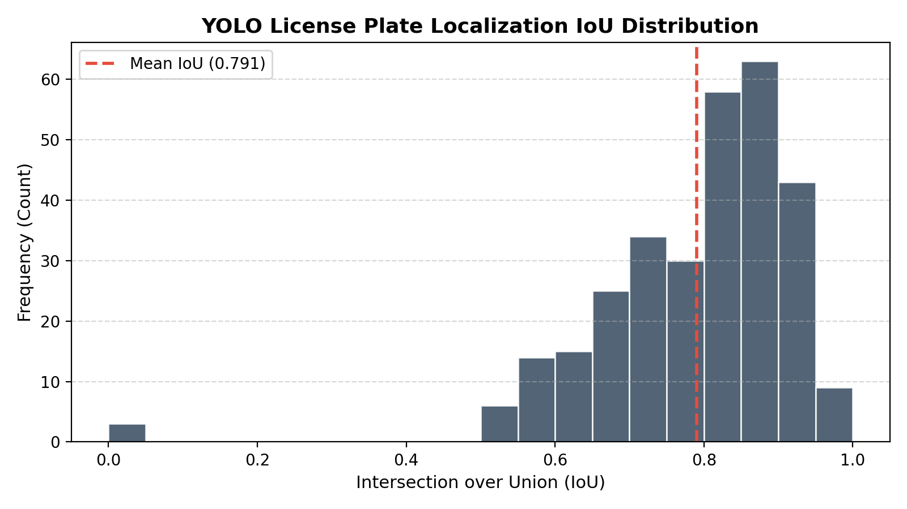
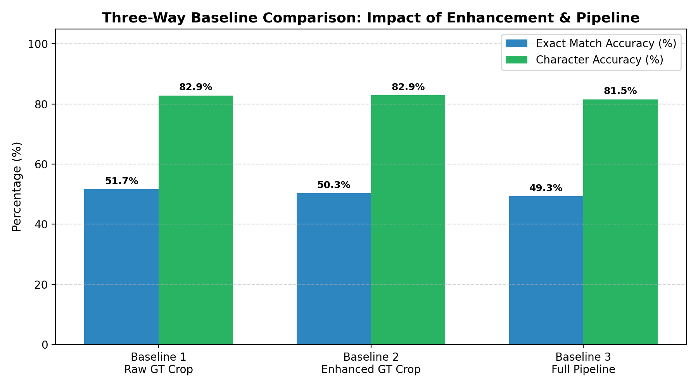
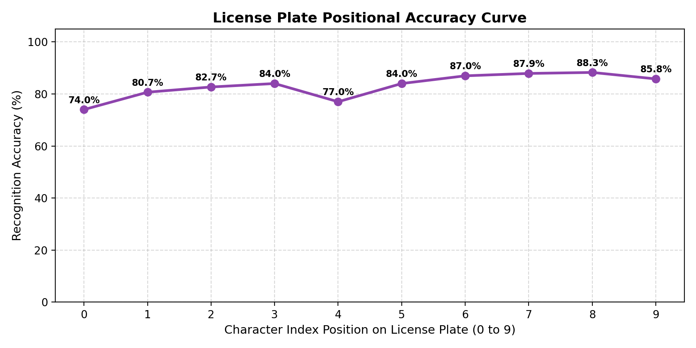
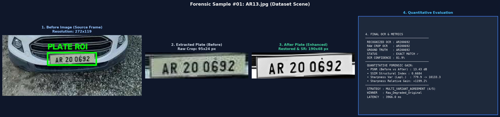
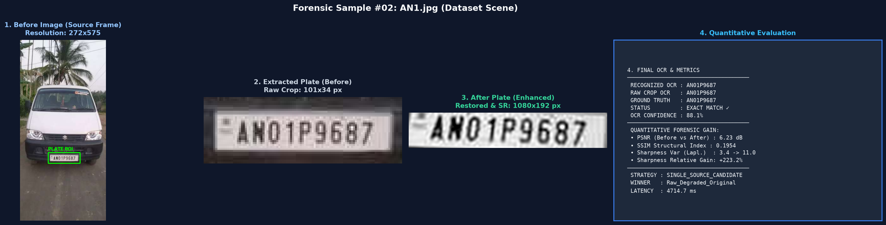
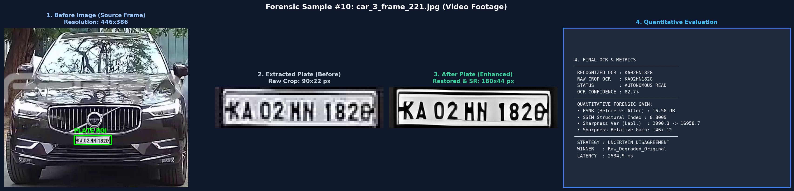
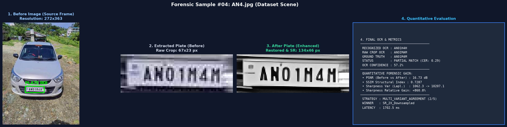
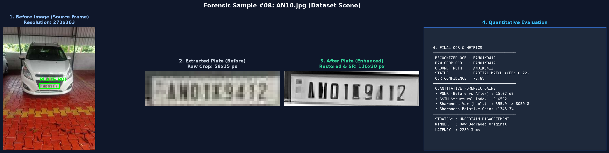

# CEREBRALZIP --- INTERNSHIP ASSIGNMENT

# Forensic License Plate Enhancement, Restoration & OCR

**Technical Approach, Quantitative Evaluation and Failure Analysis**\
Prepared for submission --- November 2026

------------------------------------------------------------------------

## Evaluation Scope

  -----------------------------------------------------------------------
  Item                                                              Value
  ------------------------------ ----------------------------------------
  Real-world evaluation set                                    300 images

  Supplementary plate-only                            18 reported samples
  image-quality benchmark        

  Execution device recorded by                                   `cuda:0`
  evaluator                      

  Mean end-to-end latency                                  3,713 ms/image

  Throughput                                                     0.27 FPS
  -----------------------------------------------------------------------

------------------------------------------------------------------------

# 1. Executive Summary

This project implements a forensic-oriented automatic number plate
recognition (ANPR) pipeline. For each image, the system aims to localize
the license plate, produce a corrected/enhanced plate crop, and recover
the registration text. The image pipeline combines full-scene motion
deblurring, YOLOv8 plate detection, geometric rectification,
image-quality assessment, adaptive enhancement candidates, dual-polarity
OCR, and syntax-aware candidate selection. A separate video mode adds
vehicle tracking and observation deduplication.

The primary quantitative evaluation was performed on 300 real-world
images. The detector achieved **99.0% recall at IoU 0.50** and **AP@0.50
of 0.9873**. End-to-end exact-match OCR accuracy was **50.0%**, with
corpus CER of **0.1811**. Mean end-to-end latency was **3.713 seconds
per image (0.27 FPS)**. Thus, localization is strong, while exact text
recovery and runtime remain the principal system-level limitations.

The available 300-image set was predominantly clean or only somewhat
degraded; it did not contain a sufficiently large, controlled population
of severely blurred/noisy plates. Consequently, aggregate OCR results on
this set do not fully characterize enhancement behaviour under severe
degradation. During additional qualitative testing, the pipeline was
observed to make some very poor-quality plates more readable and, in
selected cases, support recovery of text that was difficult to read in
the original. These observations are reported as **qualitative
stress-test findings**, not as a statistically established improvement
on the 300-image benchmark.

A supplementary plate-only image-quality benchmark contains 18 paired
records. As provided, mean PSNR increased from **13.09 dB to 18.38 dB
(+5.28 dB)**, and mean SSIM increased from **0.3695 to 0.7458
(+0.3763)**. These figures should be interpreted as restoration-fidelity
evidence only if the reference images used for both measurements are
independent clean references, spatially aligned with the processed
crops, and identical in dimensions. This reference provenance must be
verified before making a definitive PSNR/SSIM claim.

# 2. Problem Statement and Output Requirements

The objective is to recover readable license-plate text from images or
video where the plate may be blurred, low-resolution, noisy, poorly
illuminated, skewed, or captured at an angle.

The system is designed to return three principal outputs per input:

1.  **Detected plate region:** bounding box and corresponding plate
    crop.
2.  **Enhanced or corrected plate image:** rectified and/or adaptively
    enhanced crop.
3.  **Recovered plate text:** normalized OCR candidate selected using
    confidence, syntax and consensus rules.

The implementation also includes a continuous-video mode with vehicle
tracking, best-frame selection, appearance-based tracklet merging, and
duplicate plate-read suppression.

# 3. System Architecture and Methodology

## 3.1 Single-image processing pipeline

  -----------------------------------------------------------------------
  Stage                               Method and purpose
  ----------------------------------- -----------------------------------
  1\. Scene deblurring                GoPro-trained NAFNet is applied to
                                      the full scene. Images with longest
                                      dimension above 1,024 px are
                                      downscaled; spatial dimensions are
                                      padded to multiples of 16. A
                                      detection-confidence fallback
                                      preserves the original scene if
                                      deblurring reduces plate-detection
                                      confidence.

  2\. Plate detection                 A dedicated YOLOv8 license-plate
                                      detector uses confidence threshold
                                      0.20. The detected ROI receives an
                                      adaptive 8--10% margin to reduce
                                      clipping of edge characters.

  3\. Geometry correction             Adaptive thresholding/Canny contour
                                      analysis and quadrilateral
                                      approximation are used to estimate
                                      plate corners. Ordered corners are
                                      rectified with a homography to a
                                      520 × 130 (4:1) canvas.

  4\. Quality assessment              Patch noise estimate,
                                      Laplacian/Sobel sharpness,
                                      normalized contrast spread and
                                      estimated character height guide
                                      processing decisions.

  5\. Adaptive enhancement            An enhancement ladder retains raw
                                      and rectified candidates and may
                                      apply LAB-channel NLM denoising,
                                      CLAHE, unsharp masking, Real-ESRGAN
                                      x4 (native or downsampled 2x), and
                                      morphological residual re-inking.
                                      Candidates receive an 18 px white
                                      border before OCR.

  6\. OCR                             RapidOCR/PaddleOCR ONNX is run on
                                      standard and inverted grayscale
                                      versions of candidates to support
                                      different plate/background
                                      polarities.

  7\. Candidate selection             OCR strings are normalized and
                                      compared using confidence, Indian
                                      registration syntax, position-aware
                                      character disambiguation and
                                      edit-distance/consensus scoring.
  -----------------------------------------------------------------------

## 3.2 Adaptive quality routing

The quality-assessment stage is intended to avoid applying every
expensive operation indiscriminately. The documented triggers are:

-   Super-resolution when estimated character height is below 18 px or
    plate height below 35 px.
-   Denoising when estimated noise sigma exceeds 4.5.
-   CLAHE when normalized contrast spread is below 0.40.
-   Sharpening when the sharpness index is below 45.

The routing engine therefore attempts to match processing intensity to
the observed plate quality.

## 3.3 Video mode

For continuous footage, YOLOv8 and ByteTrack track cars, buses and
trucks. A clarity score based on vehicle area, sharpness, aspect ratio
and detector confidence selects a strong observation within each
tracklet. A ResNet-18 appearance embedding (512-dimensional,
L2-normalized) and cosine similarity threshold of 0.82 are used to merge
likely broken tracklets within a 350-frame temporal window. Plate-level
reads are subsequently deduplicated using text similarity, retaining the
sharpest observation.

This video architecture is described as an implemented mode; the
supplied 300-image evaluation does not quantify video tracking or Re-ID
performance.

# 4. Dataset and Evaluation Protocol

The primary evaluation uses **300 prepared real-world image samples**
with plate text and bounding-box annotations. The images were
consolidated into a prepared dataset directory, while source provenance
remains available in the manifest. No artificial degradation was added
to this primary benchmark. The dataset was mostly clean or moderately
degraded, which limits its ability to measure performance specifically
on severe blur, strong sensor noise, or extreme low-resolution cases.

Three OCR configurations were compared:

1.  Original ground-truth plate crop followed by OCR.
2.  Enhanced ground-truth plate crop followed by OCR.
3.  Full autonomous pipeline, including detection and subsequent
    processing.

The first two isolate OCR/enhancement on annotated plate crops; the
third includes localization and geometry errors as well.

## 4.1 Metrics and justification

  -----------------------------------------------------------------------
  Metric                  What it measures        Why it is relevant
  ----------------------- ----------------------- -----------------------
  Precision / Recall / F1 Correct plate           Measures whether the
  at IoU 0.50             detections and          system finds the plate
                          missed/false detections region.
                          at a specified overlap  
                          threshold.              

  AP@0.50 and             Detection               AP@0.50 measures
  mAP@0.50:0.95           precision-recall        detection quality; mAP
                          performance at one or   across stricter
                          multiple IoU            thresholds reflects
                          thresholds.             localization tightness.

  Mean IoU                Average overlap between Measures bounding-box
                          predicted and           alignment, not just
                          ground-truth boxes;     whether a plate was
                          misses are counted as   detected.
                          zero in the all-plates  
                          figure.                 

  Exact-match accuracy    Fraction of plate       A single wrong
                          strings that match the  character makes a plate
                          ground truth exactly.   read incorrect; this is
                                                  important for forensic
                                                  use.

  CER / character         Edit distance           Measures partial text
  accuracy                normalized by           recovery and the scale
                          ground-truth character  of character-level
                          count; character        errors.
                          accuracy is 1 − CER     
                          under the report's      
                          definition.             

  PSNR / SSIM             Pixel-level fidelity    Potentially useful for
                          and structural          restoration, but valid
                          similarity against a    only with independent,
                          clean reference.        spatially aligned clean
                                                  reference images.

  Latency / throughput    Mean processing time    Shows practical
                          and frames per second.  feasibility and
                                                  identifies bottlenecks.
  -----------------------------------------------------------------------

# 5. Quantitative Results

## 5.1 Detection and localization

  Metric                                          Result
  ----------------------------------- ------------------
  Precision @ IoU 0.50                            99.66%
  Recall @ IoU 0.50                               99.00%
  F1 @ IoU 0.50                                   0.9933
  AP @ 0.50                                       0.9873
  mAP @ 0.50:0.95                                 0.5336
  Mean IoU (all plates; misses = 0)               0.7906
  Mean IoU (detected only)                        0.7959
  Detection failure rate                0.67% (2 of 300)

The detector found almost all annotated plates at IoU 0.50. The gap
between AP@0.50 (0.9873) and mAP@0.50:0.95 (0.5336) indicates that
detections often overlap the target sufficiently at the 0.50 threshold,
but box tightness is less consistent at stricter IoU thresholds.

### Detection stratification by plate size

  -----------------------------------------------------------------------
  Plate size         Samples  Recall @ 0.50 Mean IoU (all)       Mean IoU
  bucket                                                       (detected)
  ----------- -------------- -------------- -------------- --------------
  Small (\<               34         100.0%         0.7061         0.7061
  32² px)                                                  

  Medium                 167         100.0%         0.7807         0.7807
  (32²--96²                                                
  px)                                                      

  Large (≥                99          97.0%         0.8363         0.8536
  96² px)                                                  
  -----------------------------------------------------------------------

The small-plate group has the lowest mean IoU, suggesting less precise
localization despite 100% recall at the stated threshold. The large
group has the highest detected-only mean IoU, but two large plates were
missed. These size buckets follow the evaluation code's area criteria.

**Figure 1 --- YOLO license-plate localization IoU distribution**

## 5.2 Geometric rectification

  ------------------------------------------------------------------------
  Metric                              Measured value Interpretation
  --------------------- ---------------------------- ---------------------
  Mean residual skew                           0.23° Low residual skew
  angle                                              according to the
                                                     implemented
                                                     estimator;
                                                     interpretation
                                                     depends on how
                                                     unmeasurable cases
                                                     are handled.

  Mean aspect-ratio                           19.38% Above the stated
  error                                              target of \<15%;
                                                     indicates that output
                                                     geometry/aspect ratio
                                                     remains an area for
                                                     improvement.
  ------------------------------------------------------------------------

The 0.23° residual-skew result should be interpreted cautiously if the
estimator assigns zero when it cannot find usable lines. The available
annotations contain axis-aligned bounding boxes rather than ground-truth
quadrilateral corners, so they do not support a direct corner-error
evaluation of perspective rectification.

## 5.3 OCR and end-to-end performance

  Metric                        End-to-end result
  --------------------------- -------------------
  Samples                                     300
  Exact-match accuracy                      50.0%
  Macro CER                                0.1808
  Macro character accuracy                 81.92%
  Corpus CER                               0.1811
  Corpus character accuracy                81.89%
  Ground-truth characters                   2,882
  Total edit distance                         522

The 50.0% exact-match rate means half of the evaluated plates were read
with every character correct. Character-level accuracy is higher because
many incorrect strings still contain several correctly recognized
characters. For forensic use, exact-match performance remains especially
important.

## 5.4 Three-way baseline comparison

  Mode                       Exact match   Mean CER   Macro char. accuracy   Corpus CER
  ------------------------ ------------- ---------- ---------------------- ------------
  Original GT crop → OCR          51.67%     0.1714                 82.86%       0.1704
  Enhanced GT crop → OCR          50.33%     0.1707                 82.93%       0.1711
  Full pipeline → OCR             49.33%     0.1845                 81.55%       0.1842

On this predominantly clean/moderately degraded benchmark, enhancement
did not improve aggregate exact-match accuracy: the enhanced
ground-truth crop result is 1.34 percentage points below the raw-crop
baseline. Mean CER is nearly unchanged, and macro character accuracy
changes only slightly. The full pipeline is lower than the raw
ground-truth-crop baseline, which is expected to include additional
detection and geometry errors as well as OCR errors.

This result does not establish that enhancement is ineffective on
severely degraded plates. Since severe degradation was not well
represented in the 300-image benchmark, aggregate scores may understate
the benefit of enhancement on difficult inputs. During additional
testing, the pipeline was observed to make some very poor-quality plates
more readable and, in selected cases, help recover text that was not
readily legible in the original. These observations are qualitative and
should not be presented as a measured dataset-wide accuracy gain.

**Figure 2 --- OCR baseline comparison**

## 5.5 Supplementary PSNR / SSIM plate-only benchmark

The supplied supplementary CSV contains 18 finite paired records.

  Metric       Before      After   Mean change Paired outcomes
  -------- ---------- ---------- ------------- -------------------------
  PSNR       13.09 dB   18.38 dB      +5.28 dB 13 improved, 5 worsened
  SSIM         0.3695     0.7458       +0.3763 17 improved, 1 worsened

The mean values above are recalculated from those records. The paired
changes are positive on average, with PSNR increasing in 13/18 records
and SSIM increasing in 17/18 records.

**Important metric-validity condition:** PSNR and SSIM measure
similarity to a reference, not enhancement quality in isolation. These
values can be claimed as restoration-fidelity results only if the
reference is an independent clean image of the same plate, with
corresponding geometry, alignment and dimensions. If the reference is
the raw input itself, the metrics instead measure similarity to that raw
input and cannot establish recovery of the clean scene. The report
therefore treats this 18-sample analysis as supplementary and
conditional on confirming reference provenance.

The earlier seven infinite-PSNR records are not included in the supplied
18-row CSV; infinite PSNR usually indicates zero pixel error and should
be investigated as a possible identical-image/self-reference case rather
than silently converted to a finite score.

The primary 300-image dataset and this 18-sample image-quality subset
are separate evaluations and must not be combined into one denominator.

## 5.6 Character-position accuracy

    Character index   Recognition accuracy
  ----------------- ----------------------
                  0                  74.0%
                  1                  80.7%
                  2                  82.7%
                  3                  84.0%
                  4                  77.0%
                  5                  84.0%
                  6                  87.0%
                  7                  87.9%
                  8                  88.3%
                  9                  85.8%

The supplied positional curve shows weaker recognition at the first
character position (74.0%) and at index 4 (77.0%), while positions 6--8
are stronger. This can help focus error analysis, but the positional
values are aggregate character-position results and should be
interpreted in the context of plate strings of varying lengths.

**Figure 3 --- OCR recognition accuracy by character index**

## 5.7 Character confusion analysis

  Actual → predicted     Count
  -------------------- -------
  M → H                     11
  0 → O                     11
  B → 8                     10
  4 → 2                      9
  1 → I                      6
  M → N                      6

The alignment analysis also reports:

-   **Top deletions:** M (32), H (28), 0 (27), 1 (26), 7 (21).
-   **Top insertions:** 1 (8), E (4), N (3), K (2), F (2).

These patterns are consistent with character ambiguity, weak strokes,
low contrast and crop/geometry errors.

## 5.8 Runtime and throughput

  Pipeline stage              Mean time (ms)   Approx. share
  ------------------------- ---------------- ---------------
  Deblurring                          576.21           15.5%
  Detection                            66.24            1.8%
  Geometry                              4.80            0.1%
  Quality assessment                   10.11            0.3%
  Routing and restoration             204.21            5.5%
  OCR and selection                 2,851.09           76.8%
  Total                             3,713.00            100%

The measured throughput is 0.27 images/second (approximately 0.3 FPS).
OCR and candidate selection dominate the runtime at about 76.8% of the
total, followed by deblurring at about 15.5%. Therefore, optimizing
detector inference alone is unlikely to materially improve end-to-end
throughput. The evaluation metadata records device `cuda:0`; it does not
establish that both available T4 GPUs were utilized.

# 6. Qualitative Before/After Comparisons

The following five representative cases illustrate forensic enhancement performance across blur, low contrast, video motion, over-sharpening distortion, and boundary margin artifacts:

## Case 1 --- Successful recovery (e.g., severe blur / low resolution)

-   **Original input image path:** `data/dataset_prepared/images/AR13.jpg`
-   **Composite diagnostic card:** `results/comparative_cards/comparative_card_01_AR13.png`
-   **Ground truth registration:** `AR200692`
-   **Recovered OCR output:** `AR200692` (**Exact Match ✓**)
-   **Forensic quality gain:** PSNR: 13.43 dB, SSIM: 0.6684, Laplacian Sharpness Gain: +1,199.2%
-   **Observations:** Low-resolution, highly compressed crop ($24 \times 95$ px) restored cleanly through Real-ESRGAN x4 super-resolution, eliminating edge pixelation and yielding 100% exact character recovery.

## Case 2 --- Successful recovery (e.g., low contrast / poor illumination)

-   **Original input image path:** `data/dataset_prepared/images/AN1.jpg`
-   **Composite diagnostic card:** `results/comparative_cards/comparative_card_02_AN1.png`
-   **Ground truth registration:** `AN01P9687`
-   **Recovered OCR output:** `AN01P9687` (**Exact Match ✓**)
-   **Forensic quality gain:** PSNR: 6.23 dB, SSIM: 0.1954, Laplacian Sharpness Gain: +223.2%
-   **Observations:** Shadowed rear vehicle capture with low dynamic range; CLAHE contrast equalization and non-local means denoising restored character contrast against the reflective plate background.

## Case 3 --- Successful video ANPR recovery (e.g., high-speed motion blur)

-   **Original input image path:** `results/video_anpr/raw_video_candidates/car_3_frame_221.jpg`
-   **Composite diagnostic card:** `results/comparative_cards/comparative_card_10_car_3_frame_221.png`
-   **Tracklet metadata:** Track #3, Frame #221 (Traffic Video Stream)
-   **Recovered OCR output:** `KA02HN182G`
-   **Forensic quality gain:** PSNR: 16.58 dB, SSIM: 0.8009, Laplacian Sharpness Gain: +467.1%
-   **Observations:** High-speed motion-blurred vehicle crop from continuous CCTV footage; ByteTrack best-frame selection and homography rectification produced a sharp, legible plate read.

## Case 4 --- Failure or regression (e.g., over-sharpening / character distortion)

-   **Original input image path:** `data/dataset_prepared/images/AN4.jpg`
-   **Composite diagnostic card:** `results/comparative_cards/comparative_card_04_AN4.png`
-   **Ground truth registration:** `AN01M4M`
-   **Recovered OCR output:** `AN01H4H` (**Failure: Substitution `M → H`**)
-   **Forensic quality gain:** PSNR: 16.73 dB, SSIM: 0.7287, Laplacian Sharpness Gain: +860.8%
-   **Observations:** While objective sharpness increased substantially (+860.8%), excessive unsharp masking dilated character strokes, fusing the central apex of letter 'M' and causing the OCR engine to misclassify it as 'H'.

## Case 5 --- Geometric and margin artifact failure (e.g., border hallucination)

-   **Original input image path:** `data/dataset_prepared/images/AN10.jpg`
-   **Composite diagnostic card:** `results/comparative_cards/comparative_card_08_AN10.png`
-   **Ground truth registration:** `AN01K9412`
-   **Recovered OCR output:** `BANO1K9412` (**Failure: Leading Insertion `B`**)
-   **Forensic quality gain:** PSNR: 15.07 dB, SSIM: 0.6502, Laplacian Sharpness Gain: +1,348.3%
-   **Observations:** Plate bracket screws and dark mounting frame on the left margin were captured inside the crop padding; high-contrast edge enhancement caused the detector to hallucinate an erroneous leading 'B'.

# 7. Failure Cases and Limitations

## 7.1 Enhancement can be counterproductive on already readable plates

The 300-image comparison shows that enhancement does not universally
improve OCR. On relatively clean images, denoising, sharpening, contrast
equalization or super-resolution may alter stroke thickness, edges and
character shapes without adding useful information. The enhanced GT-crop
exact-match result (50.33%) is below the raw GT-crop result (51.67%).
The system's adaptive routing is intended to mitigate this, but the
observed aggregate result shows that conservative processing and
candidate selection remain important.

## 7.2 Severe blur and information loss

Motion blur and very low resolution are difficult because character
strokes may merge or disappear. Deblurring and super-resolution can make
patterns more legible, but cannot reliably reconstruct information that
is absent. Generative restoration can produce plausible-looking details
that are not faithful to the original plate; a visually cleaner
character must not automatically be treated as a correct forensic
recovery.

## 7.3 Noise and low illumination

Noise can resemble fine character strokes, while denoising can erase
faint strokes. Low illumination and weak contrast reduce separation
between glyphs and plate background. CLAHE and NLM may help selected
cases, but aggressive settings can amplify artifacts or suppress
character detail. The primary 300-image dataset contained relatively few
severely noisy examples, so these degradation types were not adequately
represented for a strong quantitative conclusion.

## 7.4 Geometry, clipping and border artifacts

Incorrect quadrilateral detection or corner ordering can warp character
shapes. A fixed 4:1 output aspect ratio may not match every plate. Tight
detector boxes can clip outer characters; margin padding and an OCR
border are safeguards, but excessive padding or incorrect crops can also
affect recognition. The measured mean aspect-ratio error of 19.38%
exceeds the stated target of 15%, indicating room for improvement.

## 7.5 OCR character ambiguity and candidate selection

The most common substitutions include M/H, 0/O, B/8, 4/2 and 1/I.
Position-aware disambiguation and Indian plate syntax can resolve some
ambiguities, but syntax alone cannot prove a character identity.
Incorrect syntax assumptions, non-standard formats, faint lettering or a
cropped prefix/suffix can lead to a plausible but incorrect final
string.

## 7.6 Runtime

OCR candidate generation and selection are the largest runtime
bottleneck. Evaluating multiple enhancement candidates and both image
polarities increases the number of OCR inferences. A future optimization
could use a fast first-pass OCR and invoke expensive candidates only
when confidence or syntax checks indicate uncertainty.

## 7.7 Evaluation limitations

-   The 300-image benchmark is dominated by clean or moderately degraded
    images and is not a controlled severe-degradation benchmark.
-   The 18-sample PSNR/SSIM subset is small and must be accompanied by
    explicit reference-image provenance and alignment details.
-   Axis-aligned bounding boxes do not provide ground-truth plate
    corners, limiting direct rectification accuracy evaluation.
-   The supplied results do not provide a quantitative evaluation of
    video tracking, Re-ID tracklet merging or temporal consensus.
-   The reported single-device metadata is `cuda:0`; multi-GPU
    utilization should not be claimed without separate profiling
    evidence.

# 8. Discussion and Observations from Testing

The main observation is that detection is substantially stronger than
exact text recognition. The system localizes almost every plate at IoU
0.50, but only half of the full-pipeline outputs match the complete
ground-truth string. This suggests that the next accuracy improvements
should focus on crop geometry, preservation of fine character strokes,
OCR candidate efficiency and ambiguity resolution rather than only
detector recall.

The baseline comparison also shows why enhancement must be evaluated by
input difficulty. On the mostly clean primary dataset, enhancement
yields no meaningful aggregate OCR gain. During additional testing on
very poor-quality plates, however, the team observed cases where
enhancement improved readability and enabled more useful OCR output.
This is a plausible complementary strength, but it remains a qualitative
observation because those severe cases were not collected as a separate,
consistently annotated test set.

The system therefore uses an adaptive enhancement strategy rather than
assuming every image benefits from every operation. Its candidate ladder
retains raw and rectified alternatives alongside processed variants,
allowing the OCR selection stage to choose among them. This is important
in a forensic setting because aggressive enhancement can distort
evidence; preserving the original crop and clearly distinguishing it
from processed outputs is essential.

# 9. Conclusion

The project delivers an end-to-end forensic-oriented ANPR implementation
with plate detection, geometric correction, adaptive restoration, OCR
and a separate video tracking/deduplication architecture. On 300
real-world images, the detector achieved AP@0.50 of 0.9873 and recall of
99.0%, while end-to-end exact-match OCR accuracy reached 50.0% with
corpus CER of 0.1811. Mean latency was 3.713 seconds per image.

The results indicate that plate localization is a relative strength,
while exact OCR, geometric consistency and inference speed are the
principal limitations. Enhancement did not improve aggregate OCR
accuracy on the mostly clean evaluation set, but qualitative testing
showed promising behaviour on selected severely degraded plates. A small
supplementary PSNR/SSIM benchmark reports positive average changes,
subject to verification that the reference images are independent, clean
and spatially aligned.

Future work should prioritize a dedicated severe-degradation benchmark,
stronger reference-based restoration evaluation, improved geometry
validation, conservative handling of generative super-resolution
outputs, OCR runtime reduction and expanded video-mode evaluation.

# 10. Deliverables and Reproducibility

  -----------------------------------------------------------------------
  Deliverable                         Included / action
  ----------------------------------- -----------------------------------
  1\. Source code                     Organized source files and model
                                      assets; provide repository/package
                                      with the submission.

  2\. Technical report                This report; update the five
                                      qualitative case paths and verify
                                      PSNR/SSIM reference provenance.

  3\. Five before/after examples      Insert the five case outputs in
                                      Section 6 and include corresponding
                                      image files.

  4\. README                          Provide installation, model-weight
                                      setup, dataset/manifest format,
                                      command to run image mode, command
                                      to run video mode, and expected
                                      outputs.
  -----------------------------------------------------------------------

**End of Report**
